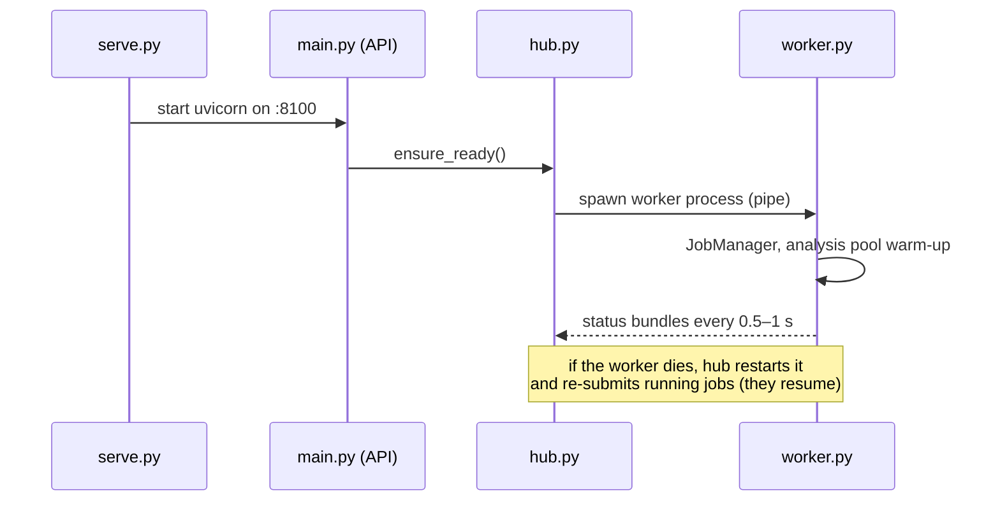
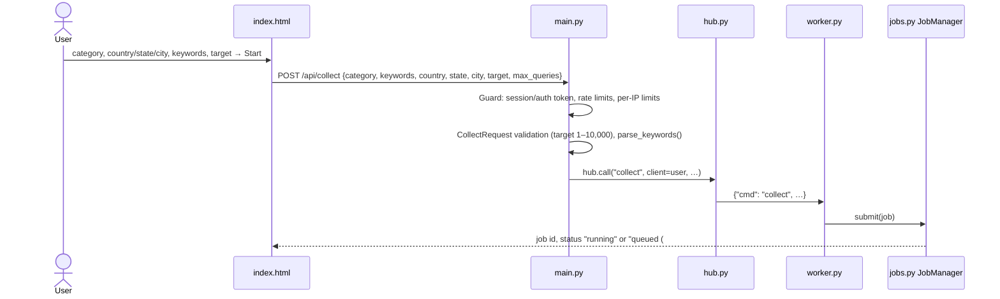
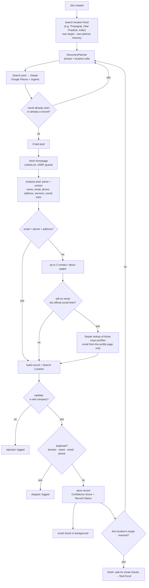
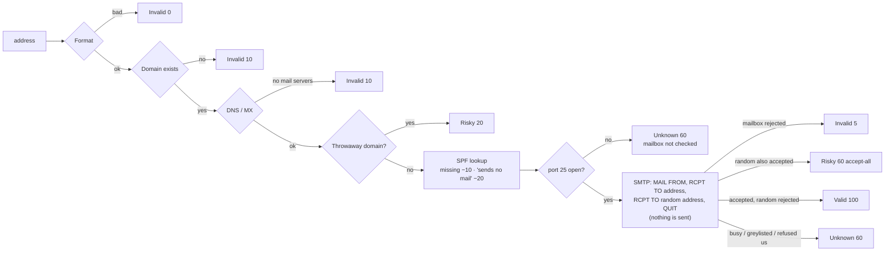

# Code Flow

What happens, in order, from the moment a user presses **Start** until the
row appears in Excel — with the file and function responsible for each step.

Modules are described in [CODE_UNDERSTANDING.md](CODE_UNDERSTANDING.md).

---

## 0. Start-up



`python -m backend.serve` → `main.py` creates the FastAPI app → the first
request calls `hub.ensure_ready()`, which spawns `worker.py` and starts
reading its status bundles.

---

## 1. The user starts a search



* **Keywords** (`categories.parse_keywords`): the text box is split on comma,
  semicolon, `|` or new line; multi-word phrases stay whole
  (`Business development executive`); duplicates are dropped.
* **Scheduling** (`jobs.py`): if fewer than `MAX_ACTIVE_JOBS` run and the
  user's category is free, the job starts; otherwise it queues. Each user
  works on their own `StateStore` (`stores.py`).

---

## 2. Inside one collection job (`engine.CollectionJob`)



### 2.1 Planning searches — `discovery.py`

* A search is a **cell** = (phrase, location). Phrases come from the user's
  keywords first, then the category's templates and sub-niche phrases.
  Locations come from `geo.expansion_geos`: a city search uses that city; a
  state search spreads over the state's cities; a country search over cities
  across its states.
* The planner learns which phrases and locations produce **new** businesses
  and spends credits there; trivial rephrasings ("top/best X") are dropped.
* When a tier runs dry it escalates: base → relaxed → expanded phrases →
  deep result pages. Nearby-city widening for a city search is off unless
  `SEARCH_NEARBY_CITIES=1`.
* Planner memory is stored **per search location**
  (`state.discovery["<category>@@<location>"]`), so a new location never
  re-runs another location's searches.

### 2.2 Searching — `search.py`, `credits.py`

* `SerperProvider.places_page` / `organic` — one credit per page.
* Before paying: the **executed-query registry** (`credits.CreditLedger`)
  and the shared response cache are checked — a search already paid for is
  never sent again.
* Every response is processed the moment it arrives; results already seen
  or already stored are skipped **before** any crawl is spent on them.

### 2.3 Crawling and extraction — `crawler.py`, `analysis.py`, `extractor.py`

* `Fetcher.fetch_raw`: SSRF check → robots.txt → fetch (redirects followed
  hop by hop, size and time limits).
* `analysis.analyze` parses the page in a worker process and returns plain
  data: name, emails, phones, address, services, contact-page links and the
  site's **official social profiles** (`crawler.social_links` — from links
  and from the page's JSON-LD `sameAs` list; share buttons and posts ignored).
* Directory / list pages are only **mined for company links**, never turned
  into records.

### 2.4 Social media fallback — `engine._social_email`

Runs only when the website (homepage + contact pages) has **no email** but
links its own Facebook / Instagram / X / LinkedIn profile:

1. One Serper search: `site:facebook.com/<handle> OR site:instagram.com/<handle> … email` (1 credit).
2. Only results that are **those exact profile pages** (or their About page)
   are read — posts, photos and reviews are ignored (they contain other
   people's emails).
3. An email in Google's preview of that page is used; its page becomes the
   record's **Email Source**.

### 2.5 Validation, dedup, storage — `validator.py`, `deduplicator.py`, `engine._try_add`

1. `validate()` rejects news sites, blogs, directories, social pages,
   rankings, records without any contact channel.
2. `confidence()` scores the record; `record_status()` labels it.
3. `DedupRegistry.check_and_add` rejects a business already stored —
   in this search, an earlier search, another location or another category.
4. `StateStore.append_record(..., loc_key)` stores it **unless this search
   location already has its target** (an earlier search elsewhere in the
   category does not count).
5. The email check is queued (2.6), the planner learns the yield, the
   credit ledger attributes the record to the search that produced it.

### 2.6 Email verification — `emailcheck.verify` (background threads)



* Results are cached per address and per domain; probes are limited to
  `EMAIL_SMTP_CONCURRENCY` at once and one per mail server every
  `EMAIL_SMTP_HOST_INTERVAL` seconds (IP-reputation protection).
* When the check finishes, the record gets Email Status / Score / Check, its
  Confidence Score is recomputed (a dead email loses its points) and its
  Record Status updated.
* Port 25 is tested once (`emailcheck.port25_open`); where it is blocked
  (Render free plan) the mailbox step is skipped automatically.

### 2.7 Checkpoints and Excel — `engine.checkpoint`, `exporter.write_category_file`

* Every few seconds the user's `state.json` is saved; the category's Excel
  file is regenerated at most every `EXPORT_MIN_INTERVAL` seconds (and only
  if its content changed). With a database, `persist.py` mirrors both.
* `exporter._layout` groups records: **sheet = searched state** (or country),
  **section = searched location**, in the order the locations were first
  searched. Each section gets a coloured heading row with its record count.
* Older records saved before location tags existed are placed by the state
  their search queries name, under "Earlier results".

### 2.8 Finishing — `engine._finish`

1. Wait (bounded) for running email checks; unfinished ones are marked
   "not checked before the run ended".
2. Final duplicate audit, checkpoint, Excel export, and a row-count check of
   the file against the stored records.
3. Status: **completed** (target reached), **stopped** (by the user —
   restarting the same location resumes), or **exhausted** (every search
   strategy used up; the stop reason says why).

---

## 3. While a job runs — status, records, downloads

```mermaid
sequenceDiagram
    participant F as index.html
    participant A as main.py
    participant H as hub.py
    participant W as worker.py
    loop every 3 s while running (10 s idle)
        F->>A: GET /api/status
        A->>H: latest bundle for this user (memory, no worker call)
        A-->>F: job snapshot: status, collected/target, search_location, log lines
    end
    F->>A: GET /api/records?category=…  (only when the data revision changed; ETag/304)
    A->>W: records RPC (cached by revision)
    F->>A: GET /api/download/05_Law_Firms.xlsx?fresh=1
    A->>W: refresh that file if records changed
    A-->>F: the workbook
```

The results table shows the **current search location** by default
(location filter next to the search box); "All locations" shows everything
in the category.

---

## 4. Failure handling (what keeps a run alive)

| Situation | What the code does | Where |
|---|---|---|
| Serper timeout / 429 / 5xx | retry with backoff; a timed-out (maybe billed) request is re-sent at most once | `search.SerperProvider._post` |
| Out of Serper credits | job pauses ("waiting"), asks the user for their own key, resumes on it | `engine._enter_credit_wait` |
| Website down / slow / blocked | logged as a failed URL; the run continues | `crawler.Fetcher` |
| A crawl task hangs | watchdog abandons it, replaces the crawl pool if needed | `engine` watchdog |
| A bug in one task | isolated, logged with context, the job continues | `engine._guarded` |
| Worker process dies | restarted by `hub.py`; jobs resume from the checkpoint | `hub.py`, `worker.py` |
| Host disk wiped (Render) | user data restored from Postgres on first use | `persist.restore` |
