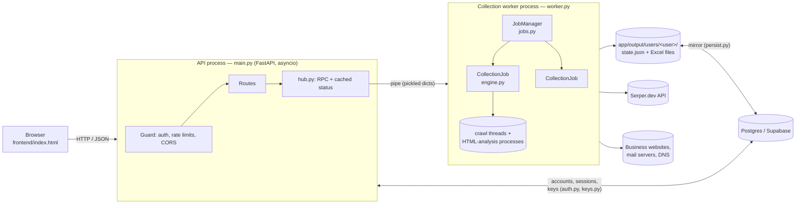

# Code Understanding

How the Business Data Collector is built: the processes, what every module
does, the data each record carries, where data is stored, and the rules that
keep users, credits and data safe.

For the step-by-step journey of one search, read [CODE_FLOW.md](CODE_FLOW.md).

---

## 1. The big picture

The app is **two Python processes** plus a single-page web UI:

**Why two processes?** Scraping is heavy (dozens of crawl threads, HTML
parsing). If it ran in the web process, every page load and status poll would
wait behind it. Instead the API answers reads **from memory** (status bundles
the worker pushes every 0.5–1 s) and only forwards *commands* (start, stop,
records, download refresh) to the worker over a pipe. If the worker crashes,
`hub.py` restarts it and the running jobs **resume from their checkpoint**.

---

## 2. Backend modules (`app/backend/`)

| File | Responsibility |
|---|---|
| `serve.py` | Production launcher: `python -m backend.serve --port 8100` (uvicorn with tuned settings). |
| `main.py` | FastAPI app: request guard (auth token, sessions, rate limits, CORS, security headers), all `/api/*` routes, serving `index.html` and Excel downloads. Reads are answered from memory. |
| `hub.py` | API-side link to the worker: starts/supervises it, multiplexed RPC (`await hub.call("collect", …)`), keeps the latest status bundle per user. |
| `worker.py` | The collection worker process: owns the `JobManager`, every user's `StateStore`, checkpoints and Excel exports; answers RPC commands; publishes status bundles. |
| `auth.py` | Accounts: sign-up / login / logout, scrypt password hashes, session tokens (only their SHA-256 is stored), admin checks. |
| `keys.py` | Per-user Serper keys: validated with Serper's free `/account` call, stored per user, only ever returned masked. |
| `db.py` | Postgres (Supabase) connection pool; tables live in a private `bdc` schema with row-level security. |
| `persist.py` | Mirrors each user's data folder (checkpoint + Excel) to the database, so data survives hosts that wipe the disk. |
| `config.py` | Every setting, read from the environment / `app/.env` with safe ranges; detects small hosts (Render free) and picks lighter defaults. |
| `fastjson.py` | Fast JSON (orjson when installed). |

## 3. Collector modules (`app/backend/collector/`)

| File | Responsibility |
|---|---|
| `jobs.py` | **Multi-user scheduling.** Up to `MAX_ACTIVE_JOBS` jobs run at once, the rest queue (FIFO); one job per category of one user's data; per-user and per-IP job limits; fair share of crawl threads. |
| `stores.py` | One `StateStore` per user (records, stats, dedup registry, credit ledger, Excel folder); loaded on demand, unloaded when idle. Shared across users: only the Serper response cache. |
| `engine.py` | **The collection engine.** `StateStore` (a user's data + checkpoint) and `CollectionJob` (one search: planner → search pool → crawl pool → extract → social fallback → validate → dedup → store → email check → Excel). Watchdog, recovery, credit-wait pause, resume. |
| `discovery.py` | **Discovery planner** — decides what each Serper credit is spent on: (phrase × location) cells, learned yield per phrase/location, strategy tiers (base → relaxed → expanded → deep result pages), retries of failed searches. |
| `categories.py` | The fixed categories (file names, query templates, relevance terms, sub-niche phrases), custom categories, **keyword parsing** (`parse_keywords`) and keyword relevance terms. |
| `geo.py` | States and cities per country, used to spread a state/country search over its cities; state name resolution ("CA" → "California"). |
| `search.py` | Search provider abstraction; `SerperProvider` (Google organic + Places): adaptive rate limiting, retries, credit accounting, timeout-billing guard. |
| `credits.py` | Credit ledger: cost and yield of every search, and the **executed-query registry** (a search already paid for is never sent again). |
| `crawler.py` | HTTP fetching (robots.txt respected, redirects followed manually through the SSRF guard), contact-page discovery, directory link mining, **official social profile detection** (`social_links`, `social_profile`). |
| `analysis.py` | Parses fetched pages in a process pool (off the GIL) and runs extraction there. |
| `dom.py` | Fast lxml-based HTML tree with the helpers extraction needs. |
| `extractor.py` | Extraction: company name, emails, phones, address, services, from JSON-LD, mailto/tel links, visible text and meta tags. Nothing is invented — missing values stay blank. |
| `validator.py` | Rejects non-companies (news, blogs, directories, social pages); **Confidence Score** and **Record Status**. |
| `deduplicator.py` | Duplicate detection by normalised domain, company name, email and phone — across runs, locations and categories. |
| `emailcheck.py` | **Email verification**: format, domain, DNS/MX, throwaway list, SPF, SMTP mailbox probe with accept-all detection; verdict + score + explanation. |
| `exporter.py` | Excel writing: one workbook per category, one sheet per state, a heading per searched location, links, number/date cells, formula-injection guard, atomic writes. |
| `normalize.py` | Text / domain / name normalisation shared by extraction, validation and dedup. |
| `ssrf.py` | Blocks fetches to private / internal addresses (search results are untrusted input). |
| `tls.py` | One shared TLS context for all HTTPS connections (large CPU saving on small hosts). |
| `prio_pool.py` | Priority thread pool: Google Places listings are crawled before low-yield directory links. |

## 4. Frontend (`app/frontend/index.html`)

One self-contained HTML file (no build step): login, category chips, location
fields, keywords (with a live "N keywords" hint), advanced options (record
target, credit estimate), Serper key panel, live progress + activity log,
results table with **location filter**, Excel downloads, admin report. It
polls `/api/status` (every 3 s while a job runs) and fetches
`/api/records` when the user's data changes.

---

## 5. The record (one row in Excel)

| Column | Meaning | Set by |
|---|---|---|
| Company Name, Category, Subcategory | Who the business is | extractor / Places / category |
| Official Website | Its site (scheme + host) | crawl / Places |
| Business Email | Email(s) found (max 3, `;`-separated) | extractor or social fallback |
| Email Status | Valid / Risky / Invalid / Unknown | `emailcheck.py` |
| Email Score | 0–100 for the best address | `emailcheck.py` |
| Email Check | Every check's result, e.g. `Format OK · Domain OK · MX OK · SPF OK · SMTP: mailbox exists` | `emailcheck.py` |
| Email Source | Exact page / social profile the email came from | `engine.py` |
| Business Phone, Full Business Address, City, State, Country | Contact details | extractor / Places / address parsing |
| Industry, Services | What it does | Places category / extractor |
| Source URL | Where the business was discovered (search result URL or Google Maps link) | `engine.py` |
| Source Page | Page the details were read from | `engine.py` |
| Search Query, Collected At | The query that found it, timestamp | `engine.py` |
| Confidence Score | Credibility 0–100 (website 25, email 20 × its email score, phone 20, address 15, real name 10, relevant 10) | `validator.py` |
| Record Status | Verified / Likely valid / Needs review / Low quality | `validator.py` |

Kept on each record but **not** an Excel column: `Search Location`,
`Search State`, `Search Country` — the location the user searched, used to
place the record in its sheet and under its heading.

---

## 6. Where data lives

| Data | Location |
|---|---|
| A user's records, stats, dedup registry, credit ledger, planner memory | `app/output/users/<user>/state.json` (checkpoint, written every few seconds) |
| A user's Excel files | `app/output/users/<user>/*.xlsx` (regenerated from the records; unchanged files are not rewritten) |
| Accounts, sessions, saved Serper keys, mirrored user data | Postgres (`SUPABASE_DB_URL`), schema `bdc` — or local JSON files without a database |
| Serper response cache (shared, so a search is never paid twice) | `app/output/search_cache.json` |
| Logs | `app/output/app.log`, `app/output/worker.log` |

`app/output/` and `app/.env` are git-ignored: **never commit them.**

---

## 7. Rules the code enforces

* **Isolation** — a user's records, Excel files, jobs and keys are reachable
  only through their own session; one user never deduplicates against another.
* **No fabrication** — values are only ever copied from a source page or
  listing; missing fields stay empty.
* **Respectful crawling** — robots.txt is honoured; a few pages per site
  (homepage + up to 2 contact/about pages); social networks are never
  crawled directly — only Google's public result for the business's own
  profile is read.
* **No email is ever sent** — the SMTP check stops after `RCPT TO` and quits;
  probes are rate-limited per mail server.
* **SSRF protection** — every fetch and every redirect, and every mail
  server the SMTP check connects to, must resolve to a public address.
* **Credit safety** — a paid search is never repeated; per-run cap
  (`MAX_CREDITS_PER_RECORD × target`) and per-network daily cap; a run that
  runs out of credits pauses and resumes on a new key.
* **Data preservation** — Excel files are rebuilt from the stored records,
  so earlier records are never altered; a new search location only adds rows
  under its own heading.
